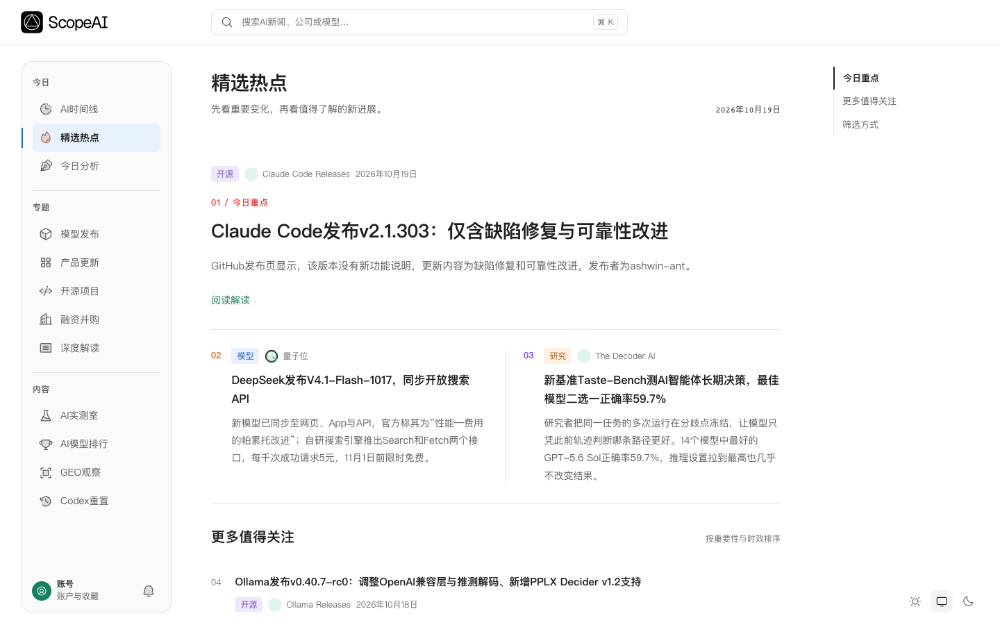
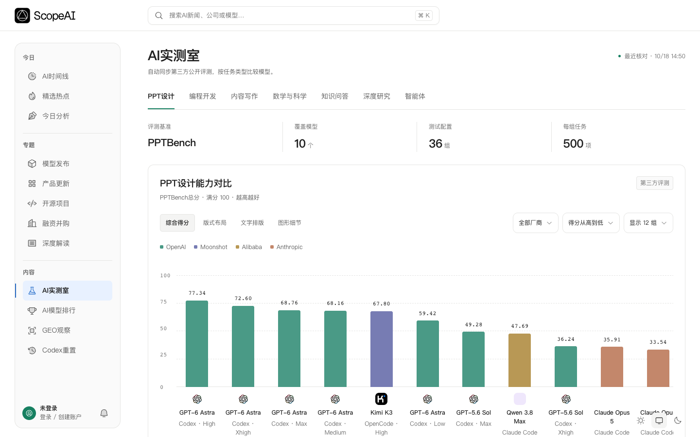

<picture>
  <source media="(prefers-color-scheme: dark)" srcset="assets/brand-light.png">
  
</picture>

# ScopeAI · AI news, model comparisons and GEO observation

Follow AI developments, compare models by task, track public Codex quota-reset announcements and explore how AI answers mention your brand. ScopeAI is a Chinese-language platform with an [English overview](https://scopeai.cc/en).

[Visit ScopeAI](https://scopeai.cc/) · [AI benchmark lab](https://scopeai.cc/lab) · [Codex reset tracker](https://scopeai.cc/codex-resets) · [GEO services](https://scopeai.cc/geo-services) · [中文](README.md)

## Explore the website

| Feature | What you can do | Open |
| --- | --- | --- |
| AI news timeline and highlights | Follow model releases, product updates, open-source projects and funding news with links to original sources | [Timeline](https://scopeai.cc/) · [Highlights](https://scopeai.cc/hot) |
| Analysis and explainers | Read context and analysis of important AI developments | [Daily analysis](https://scopeai.cc/observations) · [In-depth articles](https://scopeai.cc/insights) |
| AI model rankings | Explore model comparisons to help shortlist models | [Rankings](https://scopeai.cc/ranking) |
| AI benchmark lab | Explore third-party public evaluations for presentations, coding, writing, math and science, knowledge Q&A, research and agent tasks | [Benchmark lab](https://scopeai.cc/lab) |
| Codex reset tracker | Read public quota-reset announcements, historical records and related updates; distinguish quota resets from reset cards | [Codex resets](https://scopeai.cc/codex-resets) |
| GEO brand observation | Explore brand mentions, recommendations and citation evidence, with service details and a private brand workspace | [Service overview](https://scopeai.cc/geo-services) · [Workspace](https://scopeai.cc/geo) |
| RSS and Agent integration guides | Subscribe in a feed reader or review AI Agent / MCP integration options and service boundaries | [RSS](https://scopeai.cc/rss.xml) · [Agent docs](https://scopeai.cc/agents) |

The benchmark lab presents third-party evaluations; scores from different benchmarks and configurations require their own context. The Codex tracker is an independent information service, not an official OpenAI product. Check your account's usage page for your personal remaining quota and reset time.

### Website screenshots

View the AI benchmark lab

Actual website screenshots captured on October 19, 2026. News, models and evaluation results change as the website is updated.

## GEO API and developer access

This repository contains product information, GEO API documentation, API contracts and client examples. Website features and paid API availability are described separately.

[Request API access](https://scopeai.cc/developers) · [Integration guide](docs/getting-started.md)

> **Integration preview:** paid API production activation is pending. Confirm availability before funding an account. [Service status](docs/status.md)

## GEO observation

Create a private brand project, manage questions and competitors, purchase public-source research or specified model-answer sampling, and query original answers, source evidence and historical results. Scheduled monitoring requires separate authorization and a monthly budget.

The interface is a design preview; numbers come from verified September 7, 2026 records. Lutule received 2 mentions and 2 explicit recommendations across 11 natural questions. This single observation is not a stable industry ranking or brand endorsement. [Case details](docs/showcase.md)

The historical case used DeepSeek with web search enabled. The first API sampling target uses the **DeepSeek model API with search disabled**, not its consumer website or app, and does not promise to reproduce these scores. Public-source research is billed separately and is not measured multi-platform visibility.

## Pricing and access

Paid operations require an enabled product, prepaid account balance and an API key authorized to spend. Initial prices below are previews; final availability and quotes come from the service.

| Service | CNY | Unit |
| --- | ---: | --- |
| Public-source research | **1.00** | Fully delivered run |
| Model-answer sampling | **1.00** | Successful question × repetition unit |

Tasks reserve the maximum quote, charge successful deliveries and release failed portions. A valid answer without a brand mention is still billable. Valid retries with the same request key do not create duplicate charges. Scheduled monitoring requires separate authorization and a monthly budget. [Billing rules](docs/pricing.md)

1. [Create an account](https://scopeai.cc/login?mode=register) and visit the [developer portal](https://scopeai.cc/developers).
2. Confirm availability with [support](https://scopeai.cc/account/billing), then fund your balance through the current support-assisted process.
3. Create an API key, authorize GEO spending, set budgets and call from your server.
4. Check results, balance and transactions. Reading previously purchased results has no additional charge.

## Developer resources

[Integration guide](docs/getting-started.md) · [OpenAPI 3.1](openapi.json) · [Python](examples/python/quickstart.py) · [TypeScript](examples/typescript/scope-client.ts)

[Use cases](docs/use-cases.md) · [FAQ](docs/faq.md) · [Releases](https://github.com/choolena5-cpu/scopeai-api/releases)

---

This repository publishes GEO observation documentation, design previews, API contracts and client examples. The analysis engine, billing implementation, customer data and backend source remain private. Downloading the repository does not grant model credits or access to customer data.
