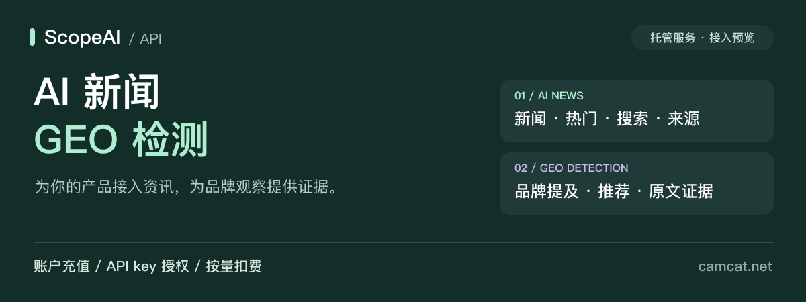
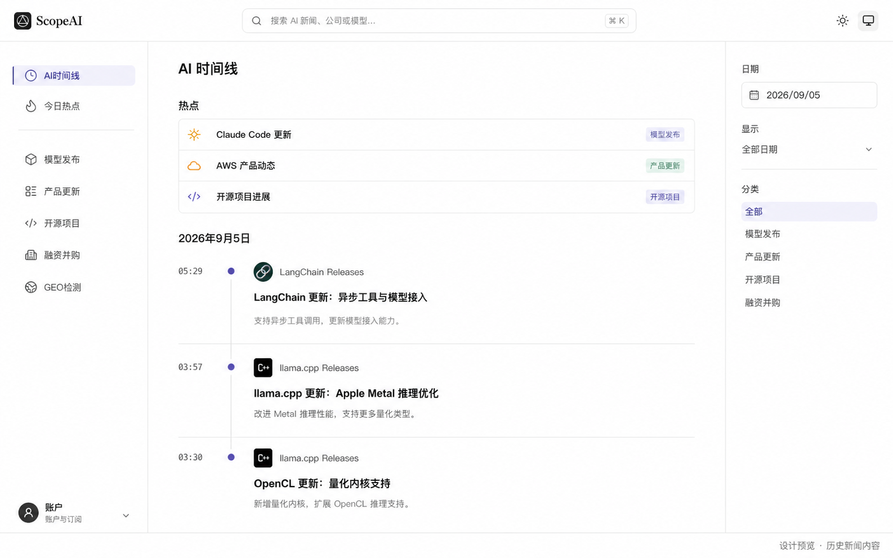
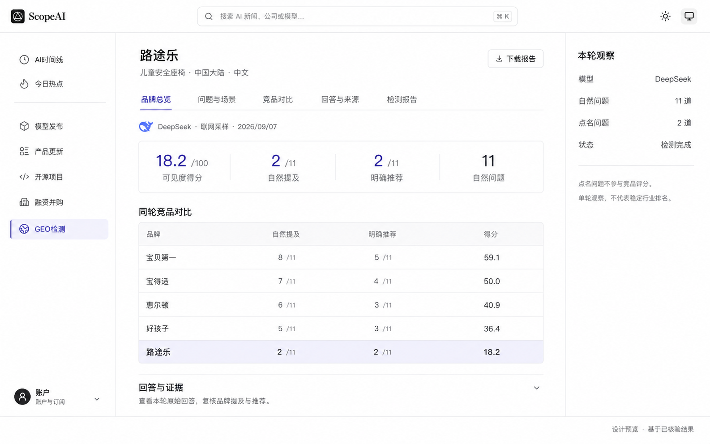

<div align="center">



**把 AI 新闻接入你的产品，让品牌在 AI 回答中的表现有据可查。**

[申请 API 接入](https://camcat.net/developers) · [体验产品](https://camcat.net) · [价格与扣费](docs/pricing.md) · [English](README.en.md)

</div>

> **接入预览** · 托管服务采用账户充值、API key 授权和按量扣费。付费 API 待生产开放，请先确认服务可用，再充值。[开放状态](docs/status.md)

## 两项服务，接入你的业务

| **01 / AI 新闻** | **02 / GEO 检测** |
| :--- | :--- |
| 给网站、App、行业助手接入 AI 资讯。 | 查看 AI 回答是否提到、推荐你的品牌。 |
| 新闻列表、搜索、热门、专题、正文与来源。 | 品牌资料观察、指定模型回答采样与历史结果。 |
| 用于资讯栏目、企业日报、主题追踪。 | 用于品牌诊断、客户报告、周期观察。 |
| **¥0.01 / 非空成功请求**，一页最多 50 条。 | **¥1 / 成功回答采样单元**；资料观察另计。 |

以上为首版预览价格，实际开放范围与金额以服务端价目和报价为准。

## AI 新闻：你的产品，也能拥有资讯时间线

把本站公开新闻接入自己的界面，按日期、分类或关键词筛选，保留摘要与来源；还可以同步内容修改和撤回。

[](https://camcat.net)

<sub>新闻产品历史实景截图，画面日期为 2026-09-05。展示网站效果，不代表新闻 API 已正式开放。</sub>

**可以这样用：** 给 AI 工具导航增加新闻栏目；每天生成企业 AI 日报；让行业助手按主题检索资讯。新闻 API 提供本站公开内容，具体字段见 [OpenAPI](openapi.json)。

## GEO 检测：用户问 AI 时，你的品牌出现了吗？

围绕品牌所属品类观察模型回答，区分“提到品牌”和“明确推荐”，结合原文证据查看竞品差距。资料观察和模型实际回答采样是两种服务，分别报价。

### 路途乐案例 · 从回答中发现品牌可见度差距



<sub>依据 2026-09-07 已核验记录制作的结果可视化，非产品界面截图。11 道自然问题使用 DeepSeek 联网采样；2 道点名问题不参与图中比较。单轮小样本不代表稳定行业排名、产品质量或市场份额，也不表示品牌背书。</sub>

这张图回答三个实际问题：**品牌有没有出现？AI 有没有明确推荐？同一批回答里，哪些竞品更常被提到？** 后续可在保持模型、问题与口径一致的条件下持续观察，并回到原始回答复核。

**可以这样用：** 品牌团队发现内容缺口；服务商为客户制作有原文依据的检测报告；SaaS 接入采样任务和历史结果，构建自己的品牌观察工具。[查看展示说明](docs/showcase.md) · [更多业务案例](docs/use-cases.md)

> **案例与首版 API 的范围不同：** 上图是网站既有检测案例，使用联网采样。首版付费 API 的实际回答采样目标为 **DeepSeek 模型 API，搜索关闭**，不等同于其网页 / App，也不承诺复现上图分数。其他 AI 平台的实测能力以开放清单为准。

## 如何接入，如何付费

1. **创建账户**：在 [ScopeAI](https://camcat.net/login?mode=register) 注册，进入[开发者工作台](https://camcat.net/developers)。
2. **确认开通并充值**：到[充值与账单](https://camcat.net/account/billing)页联系官方客服，确认所需服务开放后充值；当前由客服协助、管理员核实收款后入账。
3. **创建 API key**：授予所需消费权限，设置账户和密钥预算，在自己的服务器调用。
4. **按实际交付扣余额**：查看任务结果、可用余额及消费流水。

| 服务 | 首版预览价格 | 如何结算 |
| --- | --- | --- |
| 新闻数据 | **¥0.01 / 非空成功请求** | 一页最多 50 条；正文详情另算一次 |
| 公开资料观察 | **¥1.00 / 完整交付轮次** | 未达交付条件整轮不收费 |
| DeepSeek 模型 API 回答采样 | **¥1.00 / 成功单元** | 单元 = 一道问题的一次采样 |
| 定时监测 | 按每轮实际服务 | 单独授权，受月预算约束 |

例如：读 100 条新闻摘要，分两页，共 **¥0.02**。采样 20 道问题，先冻结最高 **¥20**；18 次成功、2 次失败，扣 **¥18**、释放 **¥2**。成功回答即使未提到品牌也正常计费。

扣的是**已充值的 ScopeAI 账户余额**。GEO 先冻结最高费用，再按成功交付结算；相同请求编号的合规重试不重复扣费。余额、报价、已购买结果与账单查询不额外收费。[完整计费规则](docs/pricing.md)

## 开发者：一次新闻读取

服务已开通且账户有余额时，下面的非空成功请求消费 **¥0.01**。密钥只放在你的服务器环境中。

```bash
export SCOPE_BASE_URL="https://camcat.net"
# 用环境变量或密钥管理工具注入 SCOPE_API_KEY。
# 为这次业务操作生成并保存 NEWS_REQUEST_KEY；网络重试复用它。

curl "$SCOPE_BASE_URL/api/v1/news/articles?limit=50" \
  -H "Authorization: Bearer $SCOPE_API_KEY" \
  -H "Idempotency-Key: $NEWS_REQUEST_KEY" \
  -H "X-Max-Charge-Cents: 1"
```

| 开始接入 | 了解服务 |
| --- | --- |
| [完整接入指南](docs/getting-started.md) | [价格与扣费](docs/pricing.md) |
| [OpenAPI 3.1 接口契约](openapi.json) | [服务开放状态](docs/status.md) |
| [Python 示例](examples/python/quickstart.py) | [常见问题](docs/faq.md) |
| [TypeScript 客户端](examples/typescript/scope-client.ts) | [截图与案例说明](docs/showcase.md) |

## 公开接入资料，核心服务由 ScopeAI 提供

本仓库公开产品说明、展示图、接口契约和客户端示例。**新闻数据库、采集系统、GEO 分析引擎、计费后台与服务端源码保持私有。** 下载本仓库不能自行运行完整平台，也不会获得免费数据或模型额度。

付费业务必须连接 ScopeAI 托管 API，并通过账户、服务开放状态、密钥权限、预算和余额校验。用户只能访问自己获授权的项目与购买结果。

---

<div align="center">

**给产品接入 AI 新闻，为品牌建立 GEO 观察能力。**

[申请接入](https://camcat.net/developers) · [联系客服与充值](https://camcat.net/account/billing) · [关注开放公告](https://github.com/choolena5-cpu/scopeai-api/releases)

文档或示例问题可提交 Issue；账户信息、充值凭证与密钥请通过官方客服处理。

</div>
