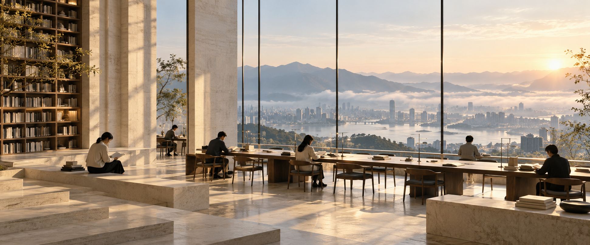

# ScopeAI 视觉说明

本轮品牌展示以“理解 AI 的入口，观察未来的尺度”为主题。两幅影像分别表达观察的远见，以及知识、创造与人的可能。

## 于时代的潮汐中，凝视远方

建筑形成观察的窗口，海平线延伸视野，人的尺度保留在画面之中。

## 让知识、创造与人的可能相遇

光线、阅读与开阔的视野，呼应技术最终回到人的知识、创造与生活。

两图均为 AI 创作的品牌概念影像，不是网站截图、实际办公场所或客户案例，不用于证明产品效果。网站实际内容请访问 [scopeai.cc](https://scopeai.cc/)。

[返回 ScopeAI](../README.md)
